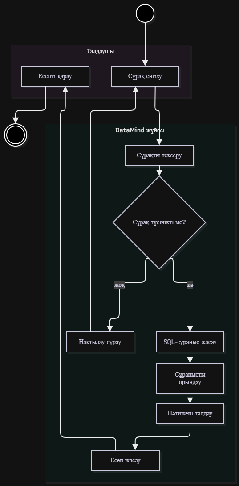

# DataMind

Автор: Халибеков Жанибек, ВТ(КИ)-24-1a

## Мәселе
Деректер қорымен жұмыс істеу үшін SQL білу және талдауға көп уақыт жұмсау керек. DataMind көпагентті жасанды интеллект жүйесі пайдаланушының сұрағын табиғи тілде қабылдап, деректер қорын автономды талдайды және дайын есеп береді. Жүйе деректер талдаушыларына және SQL білмейтін бизнес қолданушыларына керек.

## Акторлар
- Талдаушы (пайдаланушы)
- Деректер қоры (сыртқы жүйе)

## Талаптар
### Функционалдық
1. Жүйе табиғи тілдегі сұрақты қабылдауы керек
2. Жүйе сұрақ бойынша SQL-сұраныс жасауы керек
3. Жүйе сұранысты деректер қорында орындап, нәтижені талдауы керек
4. Жүйе талдау нәтижесін есеп түрінде көрсетуі керек

### Функционалдық емес
1. Жауап беру уақыты қабылдауға жарамды болуы керек
2. Жүйе деректер қорындағы деректерді өзгертпеуі керек (тек оқу)

## Диаграммалар
### 1. Use Case
(кейін қосылады)

### 2. Class
(кейін қосылады)

### 3. Activity: Деректер қорын талдау сұранысын беру

### 4. Sequence: Деректер қорын талдау сұранысын беру

